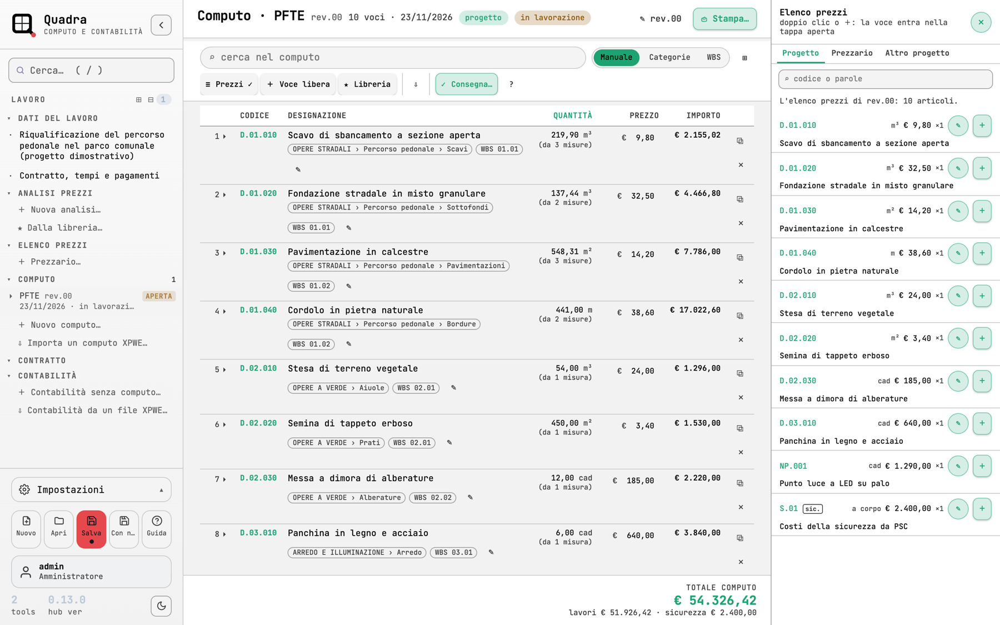

# 00 — Perché Quadra

> Questa pagina spiega cos'è Quadra e a che punto è. Per l'uso quotidiano vedi
> [02 — Guida Utente](02-Guida-Utente.md); per costruire l'app vedi il
> [README](../README.md#️-scarica).

## Il problema

Chi fa progettazione e direzione lavori di opere pubbliche in Italia lavora ogni giorno con
**prezzari regionali, computi metrici, elenchi prezzi e contabilità dei lavori** (libretto delle
misure, registro di contabilità, SAL, certificati di pagamento). Lo strumento di riferimento è un
software commerciale chiuso, che gira solo su Windows e scambia i dati in un formato proprietario
(XPWE). Chi lavora su Mac, o vuole controllare i propri dati, resta senza alternative.

## Cosa fa Quadra

Quadra è un programma **per Mac e Windows** per:

- **leggere i prezzari regionali** (tra cui Friuli Venezia Giulia, Veneto, Lombardia, Valle
  d'Aosta, Basilicata, Emilia-Romagna, Cratere Centro Italia) e cercare le voci;
- **comporre il computo metrico**: elenco prezzi, misure (lunghezza × larghezza × altezza ×
  parti uguali, con detrazioni), categorie, analisi prezzi;
- **scambiare il computo con altri programmi** in formato **XPWE**, in entrambe le direzioni;
- **tenere la contabilità dei lavori pubblici** secondo il D.Lgs. 36/2023 (Allegato II.14):
  giornale dei lavori, libretto delle misure, registro di contabilità, sommario, SAL, certificato
  di pagamento, conto finale, liste in economia, verbali del Direttore dei Lavori; appalti a
  misura, a corpo e misti.

Tutto gira **in locale**: nessun account, nessun cloud, nessun dato che lascia il computer.

## Gli strumenti

- **Lavoro** — tutto il lavoro in una schermata: prezzari, elenco prezzi e analisi, computo con
  le revisioni, contratto, SAL, perizie, stato finale e CRE, con le stampe e l'XPWE.
- **Amministrazione** — utenti, studi, intestazioni dei documenti, modelli di struttura,
  visibile solo agli amministratori.

## Stato del progetto

Quadra è **in sviluppo**, prima della 1.0. Il numero di versione corrente e le novità di
ciascuna stanno in [CHANGELOG.md](../CHANGELOG.md).

Già funzionante: lettura dei prezzari regionali e dei listini in XML e fogli di calcolo, computo con misure,
categorie a tre livelli e WBS, analisi prezzi, voci a corpo e offerte a prezzi unitari,
import/export XPWE, **revisioni del computo** (PFTE → definitivo → esecutivo → contratto, con
quadro comparativo), e la contabilità completa: libretto, registro, sommario, SAL, certificato
di pagamento, lavori in economia, verbali, riserve, perizie di variante con **iter di
approvazione** e **nuovi prezzi numerati**, stato finale e conto finale, con le stampe PDF
impaginate «da registro» e il blocco degli atti alla firma del SAL.

In lavorazione verso la 1.0: impronta e data sul fascicolo firmato (contabilità digitale,
All. II.14 art. 12 c. 10), export in formato aperto e il collaudo di una commessa intera a
confronto con un programma commerciale di riferimento, al centesimo. Le funzioni assistite dall'intelligenza artificiale e il
computo dal modello IFC vengono dopo la 1.0: prima un programma di contabilità affidabile.

I documenti prodotti vanno sempre **verificati dal tecnico** che li firma: Quadra è uno
strumento di supporto, non sostituisce la responsabilità professionale.

## Origine e licenza

Quadra deriva da [**Open E.Hub**](https://github.com/bbossolo/Open-E.Hub) di Davide Bottura, una
suite open source per la progettazione impiantistica, da cui ha preso l'architettura, i lettori
dei prezzari e il motore della contabilità. Gli strumenti non pertinenti al computo e alla
contabilità (copertine degli elaborati, smistamento layer DXF) sono stati tolti.

Licenza **MIT**: l'avviso di copyright originale resta nel file [LICENSE](../LICENSE) e nei
crediti dell'app.

## Piattaforma bianca

Quadra non include prezzari, cataloghi o marchi di terzi: i prezzari si scaricano dai portali
ufficiali e si caricano nell'app (vedi [CLAUDE.md](../CLAUDE.md), sezione «Porta il tuo
prezzario»). Il nome e i dati dello studio (intestazioni, logo) si impostano in
`src/hub/data/companies.ts`.
