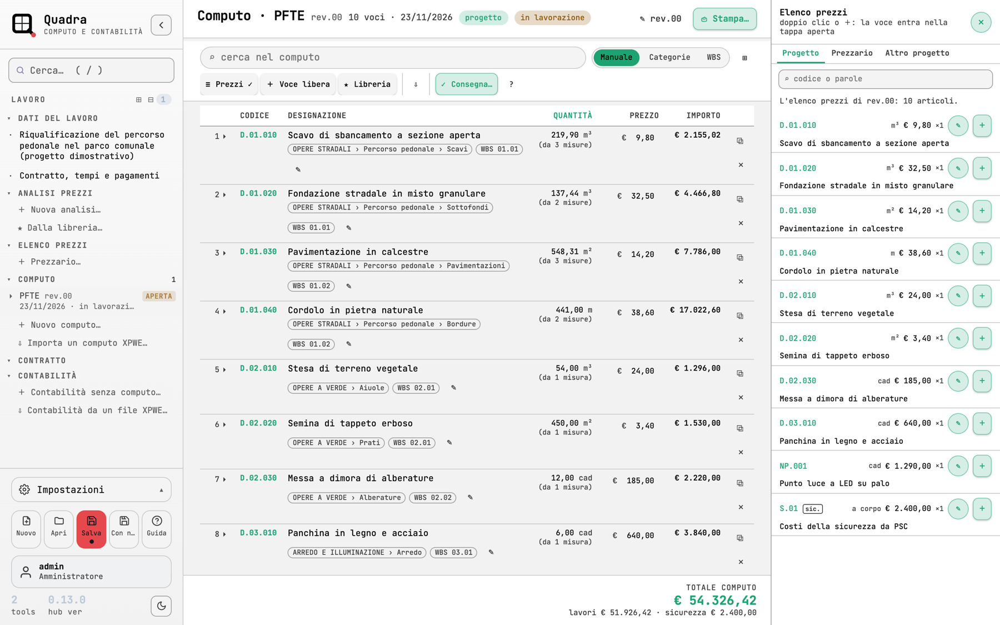
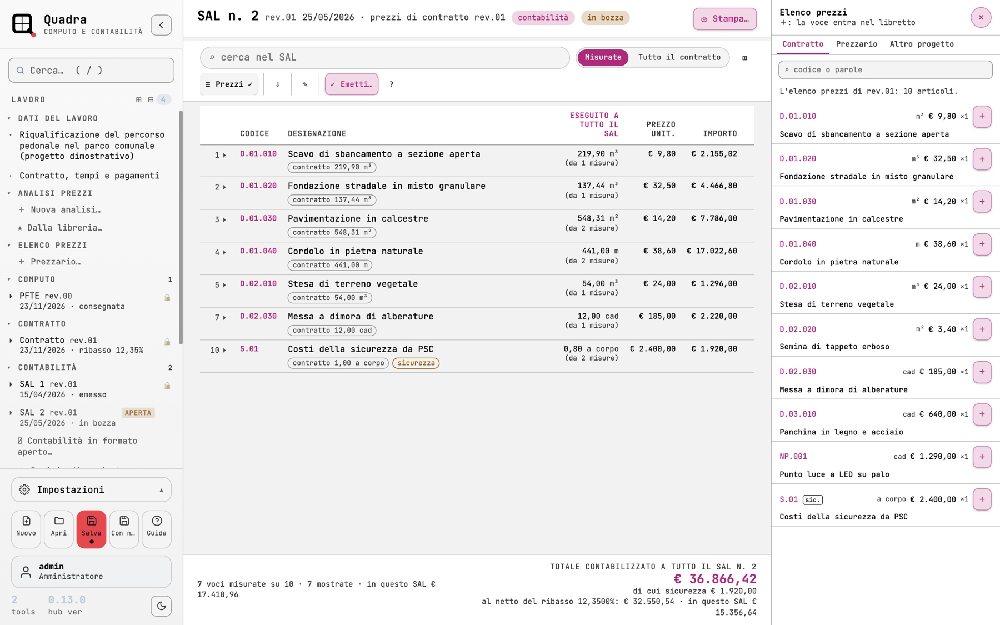
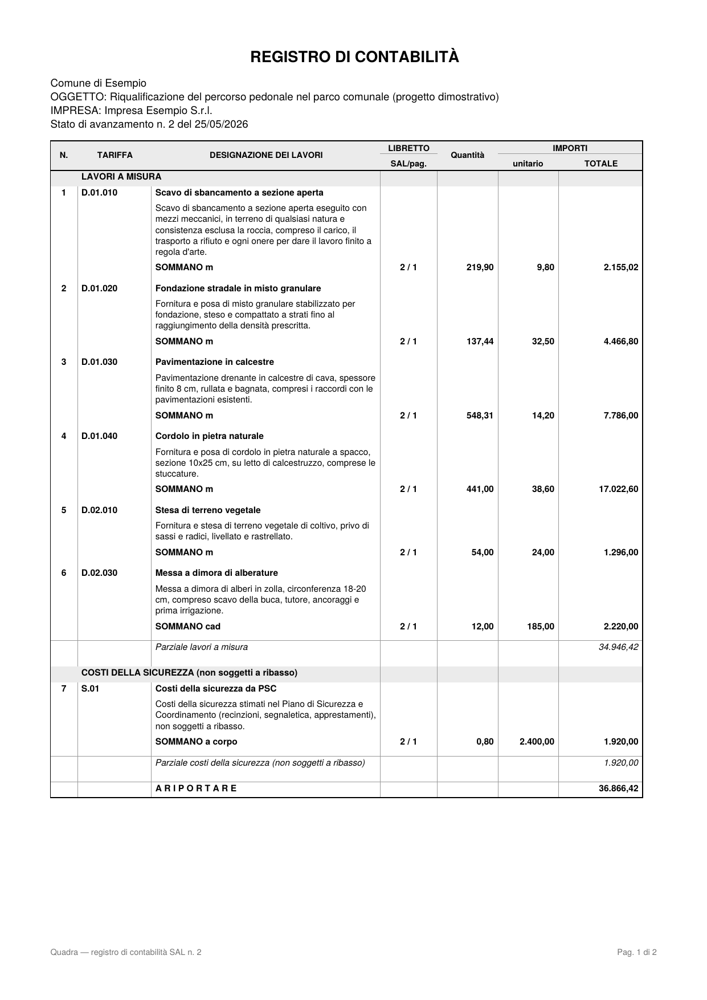

# Quadra

**Computo metrico e contabilità dei lavori pubblici, open source, per Mac e Windows.**

Quadra porta un lavoro dal computo al certificato di regolare esecuzione in **una schermata
sola**: prezzari, elenco prezzi e analisi, computo con le sue revisioni, contratto, SAL,
perizie di variante, stato finale e CRE. Produce gli atti contabili del **D.Lgs. 36/2023
(Allegato II.14)**, scambia i dati in formato **XPWE** con gli altri programmi del settore e
gira **tutto in locale**: niente account, niente cloud, niente abbonamento.

[](https://github.com/Galax65/quadra/releases/latest)
[](LICENSE)
[](https://github.com/Galax65/quadra/actions/workflows/ci.yml)



> **Stato: in sviluppo, prima della 1.0.** Il programma è completo nelle funzioni di computo e
> contabilità e i conti sono coperti da oltre 1700 test automatici, ma non è ancora stato
> collaudato su un'opera reale dall'inizio alla fine. Gli elaborati vanno sempre verificati dal
> tecnico che li firma. Vedi [a che punto siamo](#a-che-punto-siamo).

---

## Perché esiste

Chi progetta o dirige lavori pubblici in Italia passa le giornate su prezzari regionali,
computi metrici, libretti delle misure, registri di contabilità e SAL. Gli strumenti diffusi
sono commerciali, chiusi, in buona parte solo per Windows, e tengono i dati in formati che
l'utente non controlla.

Quadra nasce da un tecnico che voleva lavorare su Mac, con i propri dati in file propri, e
con un programma di cui poter leggere i conti. È **gratuito e libero** (licenza MIT): lo puoi
usare, studiare, modificare e redistribuire, anche in uno studio o in un ente.

---

## ⬇️ Scarica

Dalla pagina [**Releases**](https://github.com/Galax65/quadra/releases/latest):

| Sistema | File |
|---|---|
| Mac con chip Apple (M1–M4) | `Quadra-<versione>-arm64.dmg` |
| Mac con processore Intel | `Quadra-<versione>-x64.dmg` |
| Windows | `Quadra Setup <versione>.exe` |

Sul Mac apri il `.dmg` e trascina **Quadra** in **Applicazioni**.

<details>
<summary><b>Primo avvio: il sistema blocca l'app?</b></summary>

L'app non è firmata digitalmente (la firma ha un costo annuo e dietro il progetto non c'è
un'azienda), quindi il sistema chiede una conferma la prima volta.

- **macOS**: *Impostazioni di Sistema → Privacy e sicurezza*, scorri fino al messaggio su
  Quadra e premi **Apri comunque**. Se macOS dice che l'app «è danneggiata», apri il
  Terminale e scrivi `xattr -cr /Applications/Quadra.app`, poi riaprila.
- **Windows**: se compare «Windows ha protetto il PC», premi **Ulteriori informazioni →
  Esegui comunque**.

</details>

### Provalo in due minuti

Nella cartella [`esempi/`](esempi/) ci sono un **computo** e una **contabilità** dimostrativi
(dati inventati) in formato XPWE.

1. Apri **Lavoro** e, nella colonna a sinistra, scegli **⇩ Importa un computo XPWE…** →
   `Computo-dimostrativo.xpwe`.
2. **✓ Consegna…** il computo, poi **→ Contratto…** con un ribasso (per esempio 12,35%).
3. Sotto CONTABILITÀ, **⇩ Importa una contabilità XPWE…** → `Contabilita-dimostrativa.xpwe`:
   le misure datate diventano i SAL.
4. **⎙ Stampa…** su un SAL: libretto, registro, sommario, stato d'avanzamento, certificato
   di pagamento.



---

## Cosa fa

Un lavoro è **un albero** (a sinistra) e **una griglia** (al centro): ogni tappa si apre nella
stessa pagina, con lo stesso elenco prezzi a destra, lo stesso tasto destro e la stessa
finestra di stampa. Le tappe chiuse restano leggibili ma non si modificano più.

**Prezzi**
- Prezzari regionali in **XML, fogli di calcolo (.xlsx) e CSV**: Quadra non ne distribuisce nessuno, li scarichi
  dal portale della tua Regione e li importi. Riconosce oggi i formati di Friuli Venezia
  Giulia, Veneto, Lombardia, Valle d'Aosta, Basilicata, Emilia-Romagna, Cratere Centro Italia,
  i prezzari nei formati regionali più comuni e gli elenchi prezzi in XPWE.
- Ricerca a parole e per codice, elenco prezzi del lavoro, **nuovi prezzi**, **analisi
  prezzi** (manodopera, materiali, noli, spese generali e utile), libreria personale di voci
  e analisi da riusare, variazioni e aggiornamento dei prezzi da un prezzario nuovo.

**Computo**
- Misure: parti uguali × lunghezza × larghezza × altezza/peso, detrazioni, **formule** nei
  campi (`12+250+65`), incolla da foglio di calcolo, misure riprese da un'altra voce.
- Supercategorie, categorie e subcategorie, **WBS**, modelli di struttura riusabili; lavori a
  misura, a corpo e oneri della sicurezza.
- **Revisioni**: PFTE, definitivo, esecutivo, ciascuna congelata alla consegna, con il quadro
  comparativo tra una e l'altra. Quadro economico e confronto delle offerte.

**Contratto e contabilità**
- Il contratto nasce da un computo consegnato, **a ribasso** o **a prezzi unitari**, ed è
  subito in vigore. Per i lavori privati si apre anche una **contabilità senza computo**.
- **SAL** con l'eseguito a tutto il SAL; le voci che superano la quantità di contratto si
  vedono in blu. Importi in calce **lordi**, il ribasso a parte.
- **Perizie di variante** con il confronto sul contratto vigente e su quello originario, il
  **quinto d'obbligo**, i nuovi prezzi ribassati o no voce per voce, l'atto di sottomissione.
- **SAL finale**, stato finale, conto finale e **CRE**.
- Dati della contabilità: consegna, sospensioni e proroghe con il termine vigente,
  anticipazione, ritenute, penali, pagamenti.
- Cantiere: giornale dei lavori, verbali, riserve, lavori in economia, scadenziario e
  registro degli atti. Firma dei SAL con l'**impronta** del documento.

**Stampe ed export**
- PDF in **PDF/A-2b**: computo, computo consuntivo, elenco prezzi, stima dei lavori, analisi;
  **libretto delle misure, registro di contabilità, sommario, stato d'avanzamento,
  certificato di pagamento**, perizia, quadro comparativo, verbale dei nuovi prezzi, stato
  finale, conto finale. Anteprima con foglio, margini e carattere regolabili.
- Fascicoli in DOCX e ODT, tabelle in .xlsx, contabilità in formato aperto.
- **XPWE** in ogni tappa: computo, perizia e contabilità con le misure datate, anche per
  continuare in Quadra un lavoro iniziato con un altro programma, o per confrontarne i totali.



---

## A che punto siamo

| | |
|---|---|
| ✅ Fatto | Computo, contratto, SAL, perizie, stato finale e CRE nella stessa schermata; tutte le stampe contabili; XPWE in lettura e scrittura; PDF/A. |
| 🔜 Prossimo | **Revisione prezzi** (art. 60 D.Lgs. 36/2023); revisione dell'interfaccia; pulizia del codice ereditato. |
| 🎯 Verso la 1.0 | Un'opera reale condotta per intero in Quadra e i suoi importi verificati al centesimo contro atti già controllati; prova completa su Windows; firma del codice su macOS. |
| 🌱 Dopo la 1.0 | Computo dal modello **IFC**, proposta assistita delle voci di prezzario, misure da PDF e DXF. |

Il dettaglio è nella [roadmap](ROADMAP.md); le novità di ogni versione nel
[CHANGELOG](CHANGELOG.md).

---

## 🤝 Cerchiamo aiuto

Quadra è fatto da una persona sola, nel tempo libero. Servono soprattutto **tecnici che lo
usino** e ci dicano dove sbaglia, più che codice. In ordine di utilità:

1. **Provalo su un lavoro vero** (progettisti, direttori dei lavori, RUP, uffici tecnici).
   Rifai in Quadra un computo o un SAL che hai già chiuso con un altro programma e confronta
   gli importi: ogni differenza, anche di un centesimo, è una
   [segnalazione preziosa](https://github.com/Galax65/quadra/issues/new?template=bug.yml).
   Basta un file XPWE con dati di fantasia per riprodurla: **non allegare mai dati di un
   progetto reale**.
2. **Il tuo prezzario regionale non viene letto?** Apri una
   [issue](https://github.com/Galax65/quadra/issues/new?template=proposta.yml) indicando la
   Regione, l'anno e il link al portale ufficiale da cui si scarica. Se sai programmare, un
   lettore nuovo è un file in
   [`src/tools/computo/engine/parsers/`](src/tools/computo/engine/parsers/) più una riga di
   registro: vedi [CLAUDE.md §2](CLAUDE.md#2-porta-il-tuo-prezzario-computo).
3. **Normativa.** Revisione prezzi, contabilità semplificata sotto i 40.000 €, appalti misti,
   accordi quadro: se conosci bene un punto dell'Allegato II.14 o dell'art. 60 e vedi che
   Quadra lo tratta male, scrivilo. Una citazione precisa vale più di cento righe di codice.
4. **Windows.** Lo sviluppo avviene su Mac: chi usa Windows può dire cosa non va
   nell'installazione, nei file, nelle stampe.
5. **Stampe.** Un modello di atto usato dalla tua stazione appaltante, con le sue colonne e le
   sue diciture, aiuta a rendere le stampe accettabili ovunque.
6. **Codice.** TypeScript, motori puri e testati, nessun framework pesante. Guarda le issue con
   l'etichetta [`good first issue`](https://github.com/Galax65/quadra/labels/good%20first%20issue)
   e leggi [CONTRIBUTING](CONTRIBUTING.md).

Per domande e idee che non sono un errore usa le
[Discussions](https://github.com/Galax65/quadra/discussions).

---

## 🧭 Dal codice sorgente

Serve [**Node.js**](https://nodejs.org) 24.15 o superiore.

```bash
git clone https://github.com/Galax65/quadra.git
cd quadra
npm install           # una volta sola
npm start             # apre l'app desktop
npm run serve         # oppure: nel browser, all'indirizzo che compare
npm test              # i test
npm run build:mac     # il .dmg in dist/ (su macOS); build:win su Windows
```

**Com'è fatto.** Un'app [Electron](https://www.electronjs.org) che ospita pagine HTML
autonome costruite con Vite: l'**hub** (`src/hub/`) e gli strumenti (`src/tools/`), che si
parlano con un bus di messaggi tipizzato ([`src/shared/bus.ts`](src/shared/bus.ts)). Lo
strumento principale è **Lavoro** ([`src/tools/lavoro/`](src/tools/lavoro/)), con il
modello dei dati in [`src/shared/lavoro/`](src/shared/lavoro/); i conti della contabilità
li fa il motore puro di [`src/tools/contabilita/engine/`](src/tools/contabilita/engine/),
senza DOM e testato da Node. Le librerie esterne stanno in [`vendor/`](vendor/): niente
CDN, niente rete.

| Documento | Per |
|---|---|
| [Perché Quadra](Docs/00-Perche-Quadra.md) | origine, obiettivi, stato |
| [Guida utente](Docs/02-Guida-Utente.md) | usare il programma |
| [Panoramica e architettura](Docs/01-Panoramica-e-Architettura.md) | come sono incastrati i pezzi |
| [Build e release](Docs/03-Build-e-Release.md) | installer, versioni, CI |
| [Un lavoro, un modulo](Docs/07-Un-lavoro-un-modulo.md) | il disegno dello strumento Lavoro |
| [CONTRIBUTING](CONTRIBUTING.md) · [CLAUDE.md](CLAUDE.md) | contribuire, a mano o con un assistente AI |
| [Tutta la documentazione](Docs/README.md) | indice |

Le release si costruiscono da sole su GitHub Actions a ogni tag `v*`.

<!-- VERSIONS:START — auto-generato da versions.js (`npm run sync:readme`). NON editare a mano. -->
**Quadra v0.16.0**
<!-- VERSIONS:END -->

---

## Licenza e note

Distribuito con **licenza MIT** ([LICENSE](LICENSE)): uso libero, anche commerciale, senza
garanzia. Quadra deriva da [Open E.Hub](https://github.com/bbossolo/Open-E.Hub) di Davide
Bottura (MIT), da cui ha preso l'architettura, i lettori dei prezzari e il primo motore della
contabilità — vedi [origine e licenza](Docs/00-Perche-Quadra.md#origine-e-licenza).

Quadra **non include prezzari, cataloghi o dati di terzi**: i prezzari sono dei rispettivi enti
ed editori e li importa l'utente. I formati di interscambio sono letti e scritti solo a fini di
interoperabilità. Le librerie incluse e le loro licenze sono in [NOTICE.md](NOTICE.md).

Quadra è uno **strumento di supporto**: gli atti prodotti vanno verificati dal tecnico che li
firma, che ne resta responsabile.

Partecipando accetti il [codice di condotta](CODE_OF_CONDUCT.md). Una **vulnerabilità** non va
in una issue pubblica: segui [SECURITY.md](SECURITY.md).
